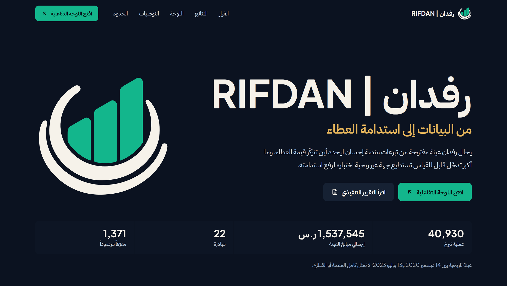

# RIFDAN | رفدان: Project Showcase Website

From data to sustainable giving. This is the source of the Arabic, right-to-left website that presents the RIFDAN donation analytics project.

**Live website:** https://ziyad-jammah.sa

## Website Preview

[](https://ziyad-jammah.sa)

**Explore Live Website:** https://ziyad-jammah.sa

<div dir="rtl">

## نبذة بالعربية

موقع تعريفي عربي لمشروع رفدان، الذي يحلل عينة مفتوحة من تبرعات منصة إحسان. يعرض القرار الموصى به والنتائج ورسوماً تفاعلية وحدود التحليل، ويقود إلى اللوحة التفاعلية والتقرير التنفيذي. النتائج وصفية ولا تمثل كامل المنصة أو القطاع.

</div>

## Overview

RIFDAN analyzes an open sample of 40,930 donation transactions to find where donation value concentrates and which measurable intervention a nonprofit could test. This website turns those results into a short visual story: the recommended decision first, then the evidence, then the limits of the analysis.

The analysis itself lives in a separate repository. This repository contains only the website.

| Resource | Link |
|---|---|
| Official website | https://ziyad-jammah.sa |
| Interactive dashboard | https://ziyad-jammah.sa/dashboard/RIFDAN_Dashboard.html |
| Dashboard on GitHub Pages | https://ziyadell.github.io/RIFDAN-Data-Analytics/outputs/dashboard/RIFDAN_Dashboard.html |
| Executive report | https://ziyad-jammah.sa/report/RIFDAN_Report.pdf |
| Analytics repository | https://github.com/ziyadell/RIFDAN-Data-Analytics |

## Features

- Full Arabic RTL layout, with isolated numbers, ranges and technical terms in mixed text.
- Hand-written SVG charts with no chart library: amount bands, Kaplan-Meier survival, entry cohorts, Cox hazard ratios, and monthly and hourly activity.
- One tooltip behavior for mouse, touch and keyboard, plus a table view for each analytical chart.
- A scroll-drawn data journey with no scroll hijacking.
- Reduced-motion support, visible keyboard focus and an accessible image dialog.
- Self-hosted fonts and no external requests from the page.

## Technology

React 19, TypeScript, Vite and plain CSS. Icons come from `lucide-react`. Browser checks use `playwright-core` with an installed Edge or Chrome.

## Getting Started

Requires Node.js 20 or newer.

```bash
npm install
npm run dev
```

The development site opens at `http://127.0.0.1:5173/rifdan-site/`.

## Production Build

Without variables, the build uses the base path `/rifdan-site/`:

```bash
npm run build
```

To reproduce the official site, serve from the root and set the public address.

Bash:

```bash
BASE_PATH=/ SITE_URL=https://ziyad-jammah.sa npm run build
```

PowerShell:

```powershell
$env:BASE_PATH='/'; $env:SITE_URL='https://ziyad-jammah.sa'; npm run build
```

| Variable | Effect |
|---|---|
| `BASE_PATH` | Path the site is served from. Default `/rifdan-site/`. |
| `SITE_URL` | Public origin for canonical and social URLs. Also writes `robots.txt` and `sitemap.xml`. |
| `PREVIEW=1` | Marks the build `noindex` and skips `robots.txt` and `sitemap.xml`. |

## Verification

| Command | Checks |
|---|---|
| `npm run verify:data` | `src/data/site-data.json` equals `source/metrics.json` |
| `npm run verify:contrast` | Text and background color pairs reach 4.5:1 |
| `npm run preview`, then `npm run verify:rendered` | Chart values, page text, links, interactions, keyboard, touch and reduced motion in a real browser |
| `node scripts/verify-release.mjs <analytics-repo-folder>` | Website copies and validation figures match the analytics release; the build holds no excluded data |

`verify:rendered` targets the default base path. To test a deployed site, run `node scripts/verify-rendered.mjs <url>`.

## Project Structure

```text
src/content.ts          Every sentence and formatted number on the page
src/sections/           One file per page section
src/charts/             Hand-written SVG charts
src/data/site-data.json Generated from source/metrics.json on every build
source/                 Analysis outputs the site reads
public/                 Fonts, brand assets, dashboard, report and previews
scripts/                Data generation, asset preparation and verification
vercel.json             Sends noindex on every host except the official domain
```

Never add `data_raw`, `data_clean` or any donor-level file to this repository.

## Deployment

The site runs on Vercel in the project `rifdan-showcase`, and is deployed from the build output with the Vercel CLI. This repository is not connected to Vercel, so pushing here does not deploy anything. The Vercel project redirects `www.ziyad-jammah.sa` and its production `vercel.app` addresses to the official domain.

## Limitations

- Results are descriptive for a historical sample, and do not represent the whole Ehsan platform or the sector.
- Donor identifiers are pseudonymous and may not represent unique people. The site shows no individual identifiers or records.
- Associations do not establish causes. Recommendations are proposals to test, not proven results.
- The source has no cost or marketing-channel data, so the analysis makes no return-on-investment or attribution claims.
- Validation figures on the site come from the analytics repository. They are not this website's own tests.

## Acknowledgments and Licensing

**Data.** This work contains information from the dataset "A sample of donations for different IDs in Ehsan", published on the [Saudi Open Data Platform](https://open.data.gov.sa/ar/datasets/view/cc3b177a-5e5d-4845-bb92-6119b1322b05) and available under the [Open Data License](https://open.data.gov.sa/ar/pages/policies/license) (ODC Attribution License), version 2.0. The cleaned data, aggregations and results were prepared by the project author, and do not imply endorsement by the licensor.

**Fonts.** IBM Plex Sans Arabic and Plus Jakarta Sans are used under the SIL Open Font License 1.1. The full texts are in [`licenses/`](licenses).

**This repository.** It does not currently include a software license. The fonts and dataset terms above apply to those items only.
